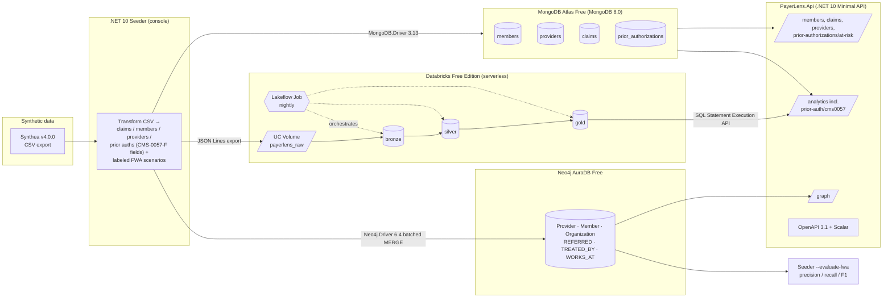

# PayerLens

**Claims, prior-authorization and provider-network analytics for a Medicare Advantage-style health plan**, built on .NET 10, MongoDB Atlas, Databricks (Delta Lake medallion pipeline) and Neo4j.

> PayerLens is a portfolio project. It is modeled on a Medicare Advantage payer domain using **100 % synthetic data** (Synthea + a deterministic generator). It is not affiliated with, endorsed by, or representative of any health plan. No PHI is used or stored anywhere in this project.

| | |
|---|---|
| **Status** | Design complete, implementation in progress (see [Project status](#6-project-status)) |
| **Docs** | Architecture, data model, API spec, test strategy and environment setup docs are added under `docs/` as the build reaches each area |
| **License** | MIT (code) · Synthea output is public-domain synthetic data |

---

## 1. The problem

A Medicare Advantage plan adjudicates millions of professional, institutional and pharmacy claims a year. Three teams need very different views of the same data:

| Persona | Question they ask | Why a single relational store struggles |
|---|---|---|
| **Payer analyst** | "Which providers drive per-member-per-month (PMPM) cost, and how is that trending?" | Needs batch aggregation across the full claim history, re-computed nightly, with lineage and data-quality gates. |
| **Care manager** | "Which of my members have open care gaps, and which open prior auths are about to miss their 72-hour / 7-day decision deadline?" | Needs low-latency, document-shaped reads of a member's full claim + auth record, with an index-backed "as of" deadline scan. |
| **SIU investigator** (Special Investigations Unit) | "Which providers refer to each other in closed loops, or share an unusual number of members — and how often is that signal wrong?" | Needs multi-hop graph traversal (referral rings, shared-patient networks) that SQL joins handle poorly, plus a labeled benchmark so precision/recall are known. |
| **Compliance / PA operations** | "What are our CMS-0057-F prior-authorization metrics per contract for last year?" | Needs an auditable, re-runnable annual aggregation over the full PA history with documented definitions. |

PayerLens serves all of them with a polyglot design: **MongoDB** for operational claim and prior-auth documents, **Databricks + Delta Lake** for the analytical (bronze → silver → gold) pipeline, and **Neo4j** for the provider-network graph, fronted by one **.NET 10 Minimal API**.

Two things make it more than a tour of three databases:

- **CMS-0057-F prior-authorization metrics.** The CMS Interoperability and Prior Authorization final rule requires impacted payers, including Medicare Advantage organizations, to decide expedited PAs within 72 hours and standard PAs within 7 calendar days (from 2026-01-01) and to publish PA metrics annually by March 31, per MA contract, excluding drugs (42 CFR 422.122(c)). PayerLens generates PA timestamps deterministically, computes the regulation's metric set in a gold table (`pa_cms0057_metrics_by_contract_year`), lists timeliness breaches, and serves an "as of" at-risk list for care managers. It is a demonstration over synthetic data with the open interpretation questions marked `[VERIFY]` in Data model §4.3; it is not a compliance filing.
- **A measured fraud detector.** The Seeder injects labeled referral-ring and shared-member scenarios (including rings hidden in high-volume legitimate traffic and benign look-alikes that must not flag), and `--evaluate-fwa` scores the Cypher catalog for precision, recall and F1 per threshold. The scorecard is in §2.1.

## 2. What this project demonstrates

| Capability | Where to look |
|---|---|
| Document modeling (embed vs reference), compound indexes, aggregation pipelines with the MongoDB C# driver 3.x | `src/PayerLens.Infrastructure/Mongo`, DATA_MODEL.md §3 |
| Medallion pipeline in PySpark on Databricks: bronze ingest → silver conformance → gold marts, scheduled with Lakeflow Jobs, with data-quality checks | `databricks/`, DATA_MODEL.md §4 |
| Graph model + Cypher for referral rings, shared-member networks and out-of-network leakage, queried from .NET with the official Neo4j driver | `src/PayerLens.Infrastructure/Graph`, DATA_MODEL.md §5 |
| CMS-0057-F PA compliance metrics: deterministic PA generator, one domain deadline function (inclusive 72 h / 7-day boundary), silver DQ, gold contract-year metrics + breach table, Analyst and CareManager endpoints with fixture-pinned expected values | `src/PayerLens.Domain/PriorAuth`, `databricks/notebooks/03_gold_marts.py`, Data model §4.3, API spec §2.1, API spec §2.5 |
| Measured fraud detection: labeled scenario injector (rings, hidden rings, benign look-alikes, shared-member pairs), `FwaEvaluator` precision/recall/F1 per threshold, scorecard in CI and below | `src/PayerLens.Seeder/Fwa`, `src/PayerLens.Infrastructure/Graph/Evaluation`, Data model §1.3, Architecture ADR-10 |
| Engineering practices: TDD with xUnit v3, Testcontainers integration tests, GitHub Actions CI, OpenAPI 3.1 + Scalar, RFC 9457 ProblemDetails, health checks, no secrets in git | TEST_STRATEGY.md |

### 2.1 Fraud-detector scorecard

Produced by `dotnet run --project src/PayerLens.Seeder -- --evaluate-fwa --labels ./export/<batchId>/fwa_labels.json` against the loaded graph; the fixture version of the same table is asserted in CI (`FwaBenchmarkTests`). Numbers in `[brackets]` are filled from the real 500-patient run at milestone S4 and must not be published as placeholders. Organic (unlabeled) hits count as false positives, so the full-dataset precision can be lower than the fixture's; that is the measurement, not a defect.

| Query | Threshold | Labeled positives | TP | FP | FN | Precision | Recall | F1 | Fixture expectation |
|---|---|---|---|---|---|---|---|---|---|
| Referral rings (2- and 3-cycles) | `minCount=2` | 4 (R1–R4) | `[ ]` | `[ ]` | `[ ]` | `[ ]` | `[ ]` | `[ ]` | 0.67 / 1.00 / 0.80 (B1, B4 flagged) |
| Referral rings | `minCount=3` (default) | 4 | `[ ]` | `[ ]` | `[ ]` | `[ ]` | `[ ]` | `[ ]` | 1.00 / 1.00 / 1.00 |
| Referral rings | `minCount=5` | 4 | `[ ]` | `[ ]` | `[ ]` | `[ ]` | `[ ]` | `[ ]` | 1.00 / 0.75 / 0.86 (R4 missed) |
| Shared-member pairs | `minShared=3` | 1 (S1) | `[ ]` | `[ ]` | `[ ]` | `[ ]` | `[ ]` | `[ ]` | 0.50 / 1.00 / 0.67 (B6 flagged) |
| Shared-member pairs | `minShared=5` (default) | 1 | `[ ]` | `[ ]` | `[ ]` | `[ ]` | `[ ]` | `[ ]` | 1.00 / 1.00 / 1.00 |
| Shared-member pairs | `minShared=8` | 1 | `[ ]` | `[ ]` | `[ ]` | `[ ]` | `[ ]` | `[ ]` | 1.00 / 1.00 / 1.00 |

Scenarios (details in Data model §1.3): `R1` obvious 2-cycle (12/12), `R2` 3-cycle (7/9/8), `R3` 3-cycle hidden inside three high-volume providers' legitimate traffic (5/6/5, < 15 % of their referrals), `R4` 2-cycle just above threshold (4/4); benign look-alikes `B1` reciprocal PCP↔cardiology pair below threshold (2/2), `B2` one-way high-volume PCP→orthopedics flow (40/0), `B3` open chain A→B→C with no closing edge, `B4` lopsided pair (10/2); `S1` collusive-looking out-of-network pair sharing 15 members; `B5` same-specialty pair sharing 12 (excluded by design), `B6` PCP/specialist sharing 4.

**Threshold-tuning note.** `minCount` is a precision/recall dial, not a constant: at 2 the detector catches everything but flags ordinary reciprocal pairs (`B1`) and lopsided pairs (`B4`); at 5 it is clean but misses low-count rings (`R4`), which is exactly how a real ring would evade it. The default of 3 is the fixture's best F1; on the full dataset the committed table shows where organic reciprocal referrals push it. For an SIU, a false positive costs an investigator-hour; a false negative costs undetected leakage, so the default leans toward recall and the API exposes the threshold so investigators choose per case.

### 2.2 CMS-0057-F note

Verified from the CMS fact sheet and 42 CFR 422.122 (links in §10): decision timeframes 72 h expedited / 7 calendar days standard from 2026-01-01; annual public reporting by March 31 at the MA contract level, first report (CY2025 data) due 2026-03-31; drugs excluded; FHIR Prior Authorization API due 2027-01-01 (out of scope). The metric columns map one-to-one to the nine data elements of §422.122(c). Project interpretations (percentage denominators = PAs decided in the year; boundary inclusive, so a decision at exactly 72:00:00 is compliant; "7 calendar days" = 168 h UTC; extension = +14 days) are documented in Data model §4.3 and marked `[VERIFY]` where CMS guidance was not checked. No real payer's data or reports are involved.

## 3. Architecture



Data flows one way (Mongo → Databricks → Neo4j) so each store has a single writer; see Architecture ADR-05 for why.

## 4. Tech stack (verified on 2026-10-26)

| Layer | Technology | Version | Notes |
|---|---|---|---|
| Runtime / language | .NET 10 (LTS) · C# 14 | Runtime 10.0.14 · SDK 10.0.403 | LTS, supported until Nov 2028. 10.0.14 was an out-of-band security release on 2026-10-25. |
| Web | ASP.NET Core Minimal APIs · `Microsoft.AspNetCore.OpenApi` · `Microsoft.Extensions.Validation` | 10.0.x (ships with the SDK) | OpenAPI 3.1 is the .NET 10 default; built-in `AddValidation()` for DataAnnotations on records. |
| API reference UI | `Scalar.AspNetCore` | 2.18.3 | Serves `/scalar` from `/openapi/v1.json`. |
| Document DB | MongoDB Atlas **Free cluster** (formerly M0) · `MongoDB.Driver` | MongoDB 8.0 · driver 3.13.0 | 512 MB, 500 connections, 100 ops/s, 10 GB/week in+out, 50-stage pipeline cap, `allowDiskUse` ignored. |
| Lakehouse | Databricks **Free Edition** (serverless only) · PySpark · Delta Lake · Lakeflow Jobs | Serverless environment v5 (Python 3.12.3) | Non-commercial use only; 5 concurrent job tasks; one 2X-Small SQL warehouse; outbound internet restricted to trusted domains; Maven/JAR libs not supported in notebooks. |
| Graph DB | Neo4j **AuraDB Free** · `Neo4j.Driver` | Aura calendar-versioned Neo4j (Cypher 5 default on existing orgs; Cypher 25 default for orgs created since 2026.02) · driver 6.4.0 | 200 k nodes / 400 k relationships / 1 GB; auto-pauses after 72 h of inactivity; **deleted after 30 days paused**. APOC Core subset pre-installed. |
| Synthetic data | Synthea | v4.0.0 (2026-03-05) | Requires JDK 17+ (LTS 17 or 25 recommended). CSV export enabled with `--exporter.csv.export=true`. |
| Testing | `xunit.v3` · Microsoft Testing Platform v2 · `Testcontainers.MongoDb` · `Testcontainers.Neo4j` · `Testcontainers.XunitV3` · `Microsoft.Testing.Extensions.CodeCoverage` | xunit.v3 4.0.2 · Testcontainers 4.16.0 | .NET 10 SDK runs MTP via `global.json` `"test": {"runner": "Microsoft.Testing.Platform"}`; coverage via `dotnet test --coverage --coverage-output-format cobertura`. |
| CI | GitHub Actions · `actions/checkout` · `actions/setup-dotnet` | checkout v7 · setup-dotnet v6 | Docker is available on `ubuntu-latest` for Testcontainers. |
| Local tooling | Docker Desktop · VS 2026 (18.11.2) or VS Code + C# Dev Kit · MongoDB Database Tools (`mongoimport` 100.19.1) · Databricks CLI | current stable | VS 2022 does **not** target .NET 10; use VS 2026 or VS Code. |
| Stretch | .NET Aspire · `Aspire.Hosting.MongoDB` | Aspire 13.x · 13.6.4 | No official or Community-Toolkit Neo4j hosting integration exists; use `AddContainer("neo4j", ...)`. |

## 5. Quick start

Full step-by-step instructions, including account creation for each free tier, are in ENV_SETUP.md. The short version:

```powershell
# 1. Prerequisites: .NET SDK 10.0.4xx, Docker Desktop, JDK 17+, Git
dotnet --version        # expect 10.0.4xx

# 2. Clone and restore
git clone https://github.com/<you>/payerlens.git
cd payerlens
dotnet restore

# 3. Store secrets locally (never in git)
dotnet user-secrets set "Mongo:ConnectionString" "mongodb+srv://<user>:<pwd>@<cluster>.mongodb.net/?retryWrites=true&w=majority" --project src/PayerLens.Api
dotnet user-secrets set "Neo4j:Uri" "neo4j+s://<id>.databases.neo4j.io" --project src/PayerLens.Api
dotnet user-secrets set "Neo4j:Password" "<password>" --project src/PayerLens.Api

# 4. Generate synthetic data and seed MongoDB + Neo4j
.\tools\synthea\run_synthea -p 500 -s 42 --exporter.csv.export=true Kentucky
dotnet run --project src/PayerLens.Seeder -- --input ./tools/synthea/output/csv --target mongo,graph,export

# 5. Run the API and open the docs
dotnet run --project src/PayerLens.Api
# https://localhost:7xxx/scalar

# 6. Run the tests (unit + Testcontainers integration; Docker must be running)
dotnet test --coverage --coverage-output-format cobertura

# 7. Score the fraud detector against the labeled scenarios (prints the §2.1 table)
dotnet run --project src/PayerLens.Seeder -- --evaluate-fwa --labels ./export/<batchId>/fwa_labels.json
```

The Databricks pipeline is set up once through the Databricks UI/CLI (upload the exported JSON Lines files to a Unity Catalog volume, import the three notebooks, create the scheduled job); see ENV_SETUP.md §4.

## 6. Project status

Milestones, checked off as they complete.

- [ ] **S1** Solution scaffold, domain records (incl. `PaDeadline`), Mongo repositories + indexes, Synthea seeder with deterministic CMS-0057-F PA generator, first 3 endpoints, unit tests, CI skeleton
- [ ] **S2** Aggregation endpoints (top-cost providers, denial rates, top diagnoses), at-risk prior-auth list with `asOf`, pagination, validation, ProblemDetails, OpenAPI + Scalar, Testcontainers Mongo tests
- [ ] **S3** Databricks: volume upload, bronze/silver/gold notebooks (claims, members, providers, prior auths), data-quality checks incl. PA checks, CMS-0057-F contract-year metrics + breach marts, scheduled Lakeflow Job, gold export
- [ ] **S4** Neo4j: graph load, constraints, referral-ring / shared-member / leakage Cypher, graph endpoints, labeled FWA scenario injector, `--evaluate-fwa` scorecard, Testcontainers Neo4j tests
- [ ] **S5** Databricks → API read-back (SQL Statement Execution API) with Mongo fallback incl. `/analytics/prior-auth/cms0057`, health checks, README diagrams + scorecard, coverage ≥ 80 %, tag `v0.1.0`
- [ ] **Stretch** JWT bearer auth + persona role policies (first) · rate limiting · cross-store care-gap outreach ranking ("why three stores?") · GraphRAG investigator assistant over the read-only Cypher catalog (after v0.1.0) · Aspire AppHost · Blazor dashboard · Lakeflow declarative pipeline with `@dp.expect` · Spark-computed shared-member edges into Neo4j · Azure Container Apps deploy

## 7. Evaluated and chose not to use

| Option | Why it was rejected (for this project) |
|---|---|
| **Azure Cosmos DB for MongoDB (vCore)** instead of Atlas | The goal is MongoDB itself; Atlas Free is a real MongoDB 8.0 replica set with the native aggregation engine, so skills transfer directly. Cosmos's MongoDB API diverges in index and aggregation behavior. |
| **EF Core MongoDB provider** (`MongoDB.EntityFrameworkCore`) | Hides the aggregation pipeline, index builders and BSON mapping this project sets out to exercise. Using the driver directly keeps them visible. |
| **Databricks MongoDB Spark Connector** (Mongo → Databricks direct) | Serverless compute does not support Maven coordinates or notebook JAR libraries, and Free Edition restricts outbound internet to trusted domains, so a live Atlas connection cannot be assumed. A file export to a Unity Catalog volume is deterministic, reproducible and cheaper. Kept as a documented alternative for a paid workspace. |
| **Lakeflow declarative pipeline (`@dp.expect`) for the MVP** | Allowed on Free Edition (one active pipeline per type), but a three-notebook Lakeflow Job is faster to build, easier to demo and shows the same medallion + data-quality pattern. The declarative version is a listed stretch goal. |
| **Neo4j GDS (Graph Data Science) algorithms** | Aura Graph Analytics sessions exist on the Free tier (one concurrent session, 4 h), but plain Cypher pattern matching already answers the SIU questions (rings, shared members). GDS would add setup time without a different story to tell — and it would need the same labeled scenarios to be evaluated, so the benchmark is the reusable part. |
| **Unlabeled anomaly scoring for FWA** | An outlier score with no ground truth cannot be given a precision or recall. Deterministic labeled scenarios (including benign look-alikes) make the detector falsifiable; the cost is that the labels are synthetic, which the scorecard states. |
| **LLM-generated Cypher (text-to-Cypher) for the stretch assistant** | Executing model-written queries against the graph is an injection and data-exfiltration surface. The stretch design restricts the model to selecting an allow-listed, parameterized catalog query and validating its parameters with the same rules as the REST endpoints. |
| **Computing the CMS-0057-F metrics in MongoDB `$group`** | Works at this size, but the annual report is a full-history, auditable, re-runnable computation — the gold layer's job, with DQ gates and a run log. Mongo keeps the operational "what is about to breach" question. |
| **Claim nodes in the graph** | 1 claim = 1 node would be fine under the 200 k-node cap for 500 patients, but aggregated relationship properties (`REFERRED.count`, `TREATED_BY.paid`) answer the questions with ~95 % fewer nodes and faster traversals. Claim nodes are a stretch item for drill-down. |
| **Controllers / MVC** | Minimal APIs with typed results, endpoint filters and the .NET 10 built-in validation are smaller, faster to write and are what the OpenAPI generator targets first. |
| **Swashbuckle** | Replaced by the in-box `Microsoft.AspNetCore.OpenApi` generator (OpenAPI 3.1 in .NET 10) plus Scalar for the UI. |
| **Coverlet collector (`coverlet.collector` 10.1.0)** | Works with VSTest, but xunit.v3 4.x defaults to Microsoft Testing Platform v2 under the .NET 10 SDK; `Microsoft.Testing.Extensions.CodeCoverage` integrates with `dotnet test --coverage` without extra wiring. |
| **.NET Aspire for the MVP** | Valuable for local orchestration, but both Mongo and Neo4j are cloud free tiers here and tests use Testcontainers. Aspire would be a second orchestration layer. Kept as a stretch goal (Aspire 13.x). |
| **Kafka / change streams for Mongo → Databricks sync** | Atlas Free supports change streams, but Free Edition Databricks cannot receive them (no inbound connectors, restricted egress). A nightly batch export is the honest fit for the free tiers. |

## 8. Repository layout

```
payerlens/
├─ README.md
├─ docs/                         # architecture, data model, API spec, test strategy, environment setup
├─ src/
│  ├─ PayerLens.Domain/          # records, value objects, no dependencies
│  ├─ PayerLens.Infrastructure/  # Mongo/, Graph/, Databricks/ adapters
│  ├─ PayerLens.Api/             # Minimal API host
│  └─ PayerLens.Seeder/          # Synthea CSV → Mongo, Neo4j, JSONL export; PA generator; FWA scenario injector + --evaluate-fwa
├─ databricks/
│  ├─ notebooks/01_bronze_ingest.py
│  ├─ notebooks/02_silver_conform.py
│  ├─ notebooks/03_gold_marts.py  # incl. pa_cms0057_metrics_by_contract_year, pa_timeliness_breaches
│  ├─ schemas/*.json
│  └─ jobs/payerlens_nightly.json
├─ tests/
│  ├─ PayerLens.UnitTests/
│  └─ PayerLens.IntegrationTests/   # Testcontainers (Mongo + Neo4j)
├─ tools/synthea/                # git-ignored Synthea checkout + output
├─ .github/workflows/ci.yml
├─ global.json                   # SDK 10.0.4xx + MTP test runner
├─ Directory.Build.props         # Nullable, TreatWarningsAsErrors, LangVersion 14
├─ Directory.Packages.props      # central package management (pinned versions)
└─ PayerLens.sln
```

## 9. How this was built

PayerLens is built with [Claude Code](https://claude.com/claude-code) as an AI pair programmer. Commits where Claude contributed carry a `Co-Authored-By: Claude` trailer, so the git history shows where it was used.

- **Method:** test-first (red, then green) for domain and pipeline logic; every change reviewed before it is committed; design decisions recorded as ADRs in the architecture doc.
- **Written by hand:** `[FILL as sessions complete]`
- **Where AI helped most:** `[FILL at v0.1.0]`
- **Where I overrode or corrected it:** `[FILL at v0.1.0]`

## 10. Sources (verified 2026-10-26)

- .NET 10 releases and 10.0.14 notes: https://github.com/dotnet/core/blob/main/release-notes/10.0/README.md · https://github.com/dotnet/core/blob/main/release-notes/10.0/10.0.14/10.0.14.md
- .NET support policy (LTS until Nov 2028): https://learn.microsoft.com/dotnet/core/releases-and-support
- C# 14: https://learn.microsoft.com/dotnet/csharp/whats-new/csharp-14
- ASP.NET Core 10 OpenAPI 3.1 / Minimal API validation: https://learn.microsoft.com/aspnet/core/fundamentals/openapi/aspnetcore-openapi?view=aspnetcore-10.0 · https://learn.microsoft.com/aspnet/core/fundamentals/validation?view=aspnetcore-10.0
- `dotnet test` with Microsoft Testing Platform (.NET 10 SDK): https://learn.microsoft.com/dotnet/core/testing/unit-testing-with-dotnet-test · coverage: https://learn.microsoft.com/dotnet/core/testing/microsoft-testing-platform-code-coverage
- xunit.v3 4.0.0 release notes: https://xunit.net/releases/v3/4.0.0 · NuGet xunit.v3 4.0.2: https://www.nuget.org/packages/xunit.v3
- MongoDB.Driver 3.13.0: https://www.nuget.org/packages/MongoDB.Driver · 3.0 upgrade guide: https://www.mongodb.com/docs/drivers/csharp/current/reference/upgrade/v3/
- Atlas Free cluster limits: https://www.mongodb.com/docs/atlas/reference/free-shared-limitations/ · Atlas getting started: https://www.mongodb.com/docs/atlas/getting-started/
- `mongoimport` (Database Tools 100.19.1): https://www.mongodb.com/docs/database-tools/mongoimport/
- Neo4j.Driver 6.4.0: https://www.nuget.org/packages/Neo4j.Driver · .NET driver manual: https://neo4j.com/docs/dotnet-manual/current/
- AuraDB Free quotas: https://neo4j.com/docs/aura/quotas-and-limits/ · instance actions (pause/delete): https://neo4j.com/docs/aura/preview/managing-instances/instance-actions/ · APOC on Aura: https://neo4j.com/docs/aura/platform/apoc/ · Cypher and Aura: https://neo4j.com/docs/cypher-manual/25/introduction/cypher-aura/
- Databricks Free Edition: https://docs.databricks.com/aws/en/getting-started/free-edition · limitations: https://docs.databricks.com/aws/en/getting-started/free-edition-limitations · serverless limitations: https://docs.databricks.com/aws/en/compute/serverless/limitations · serverless environment versions: https://docs.databricks.com/aws/en/release-notes/serverless/ (v5: https://docs.databricks.com/aws/en/release-notes/serverless/environment-version/five)
- Lakeflow Jobs: https://docs.databricks.com/aws/en/jobs/ · declarative pipelines Python ref: https://docs.databricks.com/aws/en/dlt/python-ref · expectations: https://docs.databricks.com/aws/en/ldp/expectations
- SQL Statement Execution API: https://docs.databricks.com/aws/en/dev-tools/sql-execution-tutorial · PAT: https://docs.databricks.com/aws/en/dev-tools/auth/pat · CLI `fs` commands: https://docs.databricks.com/aws/en/dev-tools/cli/fs-commands · volumes: https://learn.microsoft.com/azure/databricks/volumes/volume-files
- Synthea releases (v4.0.0, 2026-03-05): https://github.com/synthetichealth/synthea/releases · README: https://github.com/synthetichealth/synthea · CSV dictionary: https://github.com/synthetichealth/synthea/wiki/CSV-File-Data-Dictionary
- Testcontainers for .NET 4.16.0: https://www.nuget.org/packages/Testcontainers.MongoDb · https://www.nuget.org/packages/Testcontainers.Neo4j · xUnit v3 integration: https://dotnet.testcontainers.org/test_frameworks/xunit_net/
- Scalar.AspNetCore 2.18.3: https://www.nuget.org/packages/Scalar.AspNetCore · integration guide: https://scalar.com/scalar/scalar-api-references/integrations/net-aspnet-core
- GitHub Actions: https://github.com/actions/checkout/releases (v7.0.1) · https://github.com/actions/setup-dotnet/releases (v6.0.0)
- Visual Studio 2026 release notes (18.11.2, 2026-10-25): https://learn.microsoft.com/visualstudio/releases/2026/release-notes
- Aspire 13 upgrade guide: https://learn.microsoft.com/dotnet/aspire/get-started/upgrade-to-aspire-13 · Aspire.Hosting.MongoDB 13.6.4: https://www.nuget.org/packages/Aspire.Hosting.MongoDB
- CMS-0057-F fact sheet (timeframes, 2026-01-01 and 2027-01-01 dates, annual public reporting, drug exclusion, impacted payers): https://www.cms.gov/newsroom/fact-sheets/cms-interoperability-and-prior-authorization-final-rule-cms-0057-f · 42 CFR 422.122(c) metric list, March 31 deadline, MA contract level, drug exclusion (eCFR; Cornell LII mirror used because the Federal Register/eCFR block automated fetches): https://www.ecfr.gov/current/title-42/section-422.122 · https://www.law.cornell.edu/cfr/text/42/422.122 · final rule 89 FR 8976 (2024-02-08): https://www.federalregister.gov/documents/2024/02/08/2024-00895/medicare-and-medicaid-programs-patient-protection-and-affordable-care-act-advancing-interoperability · CMS Prior Authorization API FAQ (CY2025 metrics due 2026-03-31; appeals aggregated across levels): https://www.cms.gov/priorities/burden-reduction/overview/interoperability/frequently-asked-questions/prior-authorization-api · decision timeframes codified at 42 CFR 422.568(b)(1) and 422.572(a)(1) `[VERIFY text; not fetched]`
